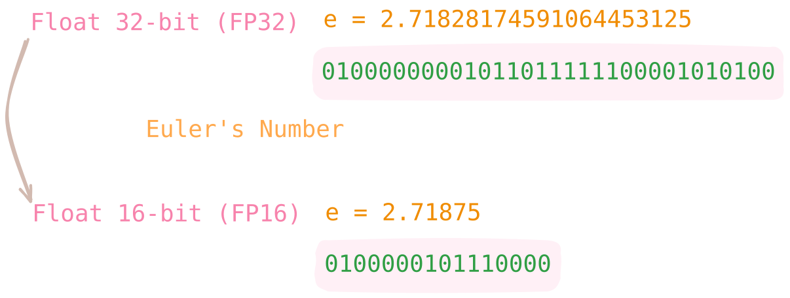

import { PythonLinkButton, NodeJSLinkButton } from '@/components/LinkButton';

Quantization is a compression technique that ***transforms vectors from their original (specifically FP32) format into a more compact representation***, reducing the size of vector indexes used for search.

This transformation approximates vectors using compact per-dimension or subvector encodings — enabling:

- ✨ Lower **memory footprint** — especially when the index is memory-resident,
- ✨ Faster I/O and lower query latency — due to reduced data movement and efficient integer/fp16 arithmetic,
- ✨ Better scalability on resource-constrained hardware.

<Callout className="text-base" type="warn">
  **Important**:
    - Quantization is a ***lossy and irreversible*** compression method. It improves runtime efficiency **at the cost of potentially reduced recall accuracy**. Always validate its effect on your retrieval quality.
    - Quantization only provides benefits when applied to vectors in a **FP32** format.
</Callout>

## Storage Behavior

To ensure data integrity and flexibility, **Zvec stores both the original vectors and their quantized versions**. This means:

- The **overall on-disk storage usage may increase** (due to storing two copies).
- **Quantized codes can reduce vector memory usage during search**. PQ training still requires original vectors, and query refinement reads reference vectors to re-score candidates.
- Users can always **retrieve the original, unaltered vectors** when needed.

## Enabling Quantization

  <PythonLinkButton url="/api-reference/python/schema/#zvec.model.schema.VectorSchema" label="Python API Reference" />
  <NodeJSLinkButton url="/api-reference/nodejs/interfaces/ZVecVectorSchema" label="Node.js API Reference" />

You can enable quantization at the time of vector index creation by selecting your preferred quantization type — e.g., `FP16`, `INT8`, `INT4`, or `PQ` — **using the `quantize_type` parameter in the index parameters passed to `VectorSchema.index_param`**, such as `HnswIndexParam` or `IVFIndexParam`.

Once set, Zvec automatically generates and manages the quantized representation alongside your original vectors.

**PQ SDK support:** Python supports HNSW/IVF PQ starting with version **0.8.1**. The **Node.js SDK 0.8.0** does not expose PQ configuration; the Node.js API links on this page do not imply PQ support in that version.

For PQ, configuring the schema is only the first step: insert representative data, then call `collection.optimize()` to train the codebooks and build the PQ index. Queries before optimization use the original Flat index.

---

## Quantization Types

The quantization options described here fall into two families: **Scalar Quantization (SQ)** encodes individual dimensions, while **[Product Quantization (PQ)](https://doi.org/10.1109/TPAMI.2010.57)** jointly encodes groups of dimensions as subvectors. Choose the family first, then its configuration. The API names remain `FP16`, `INT8`, `INT4`, and `PQ`.

### SQ (Scalar Quantization)

The scalar options below reduce the precision of each dimension independently; FP16 uses a smaller floating-point representation, while INT8 and INT4 use integer quantization.

#### FP16 (Half-Precision Floating Point)

Uses 16-bit floating-point numbers to reduce memory footprint and accelerate computation while maintaining high numerical precision. Ideal for applications requiring near-FP32 accuracy with improved efficiency. Requires conversion from FP32 source.

#### INT8 (8-Bit Integer Quantization)

Represents vectors using 8-bit integers, significantly reducing storage and memory bandwidth requirements. Offers a good trade-off between speed, size, and retrieval accuracy for many similarity search tasks. Requires conversion from FP32 source.

#### INT4 (4-Bit Integer Quantization)

Ultra-compact representation using only 4 bits per dimension. Maximizes storage density and inference speed, suitable for latency-sensitive or resource-constrained environments where noticeable accuracy loss is acceptable. Requires conversion from FP32 source.

### PQ (Product Quantization)

PQ compresses groups of dimensions into codes from trained codebooks. HNSW and IVF support PQ4, PQ8, and optional learned [OPQ](https://www.cv-foundation.org/openaccess/content_cvpr_2013/papers/Ge_Optimized_Product_Quantization_2013_CVPR_paper.pdf); IVF also supports PQ4 [FastScan](https://www.vldb.org/pvldb/vol9/p288-andre.pdf). See [Product Quantization](./product-quantization/) for configuration, training, and query refinement examples.

## Enabling Rotation

  <PythonLinkButton url="/api-reference/python/schema/#zvec.model.schema.VectorSchema" label="Python API Reference" />
  <NodeJSLinkButton url="/api-reference/nodejs/interfaces/ZVecVectorSchema" label="Node.js API Reference" />

When using `INT8` or `INT4` quantization, you can **set `enable_rotate=True` via the `quantizer_param` parameter in your index parameters** to enable rotation. This applies a random orthogonal rotation to vectors before quantization, making the distribution across dimensions more uniform, which reduces information loss during quantization and improves the recall of the quantized index. For PQ, this option enables learned [OPQ](./product-quantization/) instead.
